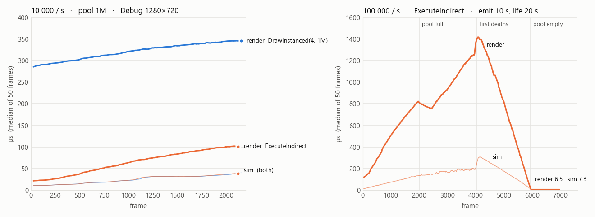
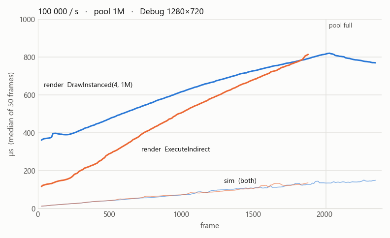

# 2026-11-17: M2, dead and alive lists with an indirect draw

*This entry closes the first half of milestone M2 in `docs/roadmap.md`.
Particles are now born from a dead list and die back into it. Only the
live ones are simulated and drawn, and their count never leaves the GPU.
The design is [ADR-0005](../adr/0005-gpu-driven-particle-lists.md).
Claude wrote the benchmark analysis and the documentation. The D3D12 and
HLSL code is hand-written, as always.*

## Four steps, each one working on its own

The work was cut so that every step ends in a system that runs and can be
checked. The speed only arrives in the last step:

1. **Dead list and emit** (2026-11-12). The dead list starts as
   `0..N-1` with `DEAD = N`. A one-thread kickoff kernel computes
   `emit = min(request, DEAD)` and `DEAD -= emit`. Emit thread `i` pops
   `DeadList[DEAD + i]` and initialises that particle. Check: particles
   appear at the rate, and spawning stops once the pool is used up.
2. **Death and recycling** (2026-11-15). Simulate pushes the index back
   with `InterlockedAdd` on `DEAD`, on the frame the particle dies and only
   then, so a dead particle never enters the list twice. Check: the system
   runs forever and the visible count settles near rate × lifetime.
3. **Alive lists** (2026-11-16). Emit appends to list A, simulate reads A
   and appends the survivors to B, then the two swap by rebinding. The
   same commit moved emit and simulate to `ExecuteIndirect` with arguments
   written by the kickoff. The draw still covered the whole pool with an
   early-out on `ALIVE_OUT`. Check: `DEAD + ALIVE == N` every frame.
4. **Indirect draw** (2026-11-17). `ALIVE_OUT` is copied into the draw's
   `InstanceCount`, so the draw covers the live particles only. Check:
   the benchmark below.

Because step 3 already made the dispatches indirect, the step-4 benchmark
compares two builds that differ in the draw only.

## What one frame does now

```
Kickoff   [CS, 1 thread]     emit = min(request, DEAD); DEAD -= emit
                             ALIVE_IN = ALIVE_OUT + emit; ALIVE_OUT = 0
                             args: emit groups, sim groups, draw (4, -, 0, 0)
Emit      [CS, indirect]     DeadList[DEAD + i] -> init -> A[ALIVE_IN - emit + i]
Simulate  [CS, indirect]     A[i] -> age, integrate
                               died:  DeadList[DEAD++]
                               alive: B[ALIVE_OUT++]
Copy                         ALIVE_OUT -> args.InstanceCount
Draw      [ExecuteIndirect]  4 vertices x ALIVE_OUT instances, VS reads Particles[B[id]]
                             A <-> B
```

`ALIVE_OUT` is final only after simulate, and the kickoff runs before it,
so the kickoff cannot write `InstanceCount`. A copy after simulate does.

## Measurement

Setup: AMD Radeon RX 7800 XT, **Debug** (shaders built with `-Od`),
1280×720, a 1 000 000-particle pool, fixed camera. The emitter defaults
apply: 10 s of emission, a 20 s lifetime, no looping. The baseline is the
step-3 draw, `DrawInstanced(4, 1M)` with the vertex-shader early-out on
`ALIVE_OUT`. The candidate is `ExecuteIndirect` with
`InstanceCount = ALIVE_OUT`. Kickoff, emit and simulate are the same code
in both builds, so `sim` is the control zone and `bloom` a second one.



*Left: both builds at 10 000 particles/s. Right: the ExecuteIndirect build
at 100 000 particles/s, from an empty pool to a full one and back. The
CSV holds no clock and no alive count, so the three markers are read
from the shape of the curves.*

**10 000 particles/s.** Emission lasts 10 s and the lifetime is 20 s, so
at most 100 000 particles (10% of the pool) are ever alive. Both runs are
about 2 150 frames of the pool filling, not a steady state, so no warm-up
was skipped. p50 / p95 in µs over the whole run:

| zone | `DrawInstanced(4, 1M)` | `ExecuteIndirect` | Δ p50 |
|---|---:|---:|---:|
| `render` (under test) | 325 / 346 | 68 / 101 | −79% |
| `sim` (control) | 25 / 38 | 26 / 38 | +1% |
| `bloom` (control) | 45 / 48 | 45 / 49 | 0% |
| `frame` | 462 / 551 | 202 / 246 | −56% |

This time the controls held. Per 200-frame window, the `sim` medians of
the two runs agree within 1.6 µs and the `bloom` medians within 0.1 µs, so
the `render` difference is real. In the M0 draw-call A/B the control had
moved ten times more than the signal.

The gap between the two `render` curves shrinks as the pool fills: 267 µs
over the first 200 frames, 244 µs over the last 200. That gap is the work
`ExecuteIndirect` removes. For every dead slot, `DrawInstanced(4, 1M)`
still runs four vertex-shader invocations, each of which loads the
counter, and then culls the two triangles they produce. With nearly the
whole pool dead that costs 267 µs, about 0.27 ns per dead slot in this
Debug build.

**100 000 particles/s, full lifecycle.** Only the ExecuteIndirect build.
This is the mislabelled run described below, and its file has since been
overwritten. 10 s × 100 000/s fills the 1M pool exactly when emission
ends. `render`
rises while the pool fills and falls while particles die. With the pool
empty it settles at **6.5 µs** (`sim` at 7.3 µs). That floor is the whole
fixed cost of the indirect render zone: the barriers, the count copy and a
draw with zero instances. `DrawInstanced(4, 1M)` never drops below about
285 µs, even with nothing alive.

While the pool is full (frames ~2 000 to ~4 050), `render` still moves
from about 800 to 1 400 µs. With the count fixed, the cost comes from the
fill of the expanding cloud. At a full pool, two draws can therefore only
be compared at the same moment of the same scene.

**100 000 particles/s, both builds.** A 10 s `DrawInstanced` run against
the ExecuteIndirect run, both covering the pool filling from empty to
(nearly) full:



The gap closes as the pool fills, as the 10 000/s runs predicted. Per
100-frame window:

| frames | `render` EI − DI (µs) |
|---|---:|
| 0–99 | −244 |
| 1 000–1 099 | −104 |
| 1 500–1 599 | −41 |
| 1 700–1 799 | −12 |
| 1 800–1 899 | +7 |

The control holds less tightly than at 10 000/s. The per-window `sim`
medians differ by up to 15 µs, because the curves are steeper here and a
small difference in frame rate shifts one run against the other. That
matters only for the last windows, which are covered under "Full pool"
below.

## A run that was not what its name said

The capture named `..._draw_instanced_rate=100'000.csv` was recorded with
the ExecuteIndirect build. Two things give it away:

- Its `render` zone drops to 6.5 µs once the pool is empty.
  `DrawInstanced(4, 1M)` cannot go below about 285 µs.
- Over the 1 914 frames it shares with `..._execute_indirect_rate=100'000.csv`,
  its 200-frame `render` medians match that run within 6 µs (12 µs in the
  last window), and its `sim` medians within 3 µs.

All four runs also carry an old note,
`note=Curl noise ORB using DrawIndexedInstanced(6N, 1)`, so the metadata
could not catch the mix-up. Only the data could.

The pair is still useful. Two runs of one build over one scenario form an
A/A test, and that sets the noise floor: in Debug, `render` differs by up
to about 6 µs per 200-frame window between two processes. That is the
same size as the effect predicted below. The file has since been
overwritten with a real `DrawInstanced` capture: the 100 000/s A/B above.

## Full pool: predicted, not yet resolved

At 1M alive, both builds draw the same instances with the same shaders.
`ExecuteIndirect` adds the count copy with its four transitions and drops
the counter UAV barrier from step 3. Its fixed cost is at most the 6.5 µs
floor. From that:

- At a full pool, `ExecuteIndirect` should be **at most 6.5 µs slower**,
  under 1% of an 800 to 1 400 µs `render` zone.
- It wins once the dead slots cost more than that:
  6.5 µs / 0.27 ns ≈ 24 000 slots, so as soon as more than **about 2.5%**
  of the pool is dead.

The 100 000/s pair cannot settle this. Near a full pool, the sign of the
difference depends on how the two runs are lined up:

- By frame index, `ExecuteIndirect` is 7 µs slower over frames
  1 800–1 899, and 26 µs slower over the last 14 frames of its run. Two
  runs of the *same* build (the A/A pair) also differed by 12 µs over
  frames 1 800–1 913.
- By equal `sim` (a stand-in for the alive count, because simulate is the
  same code in both builds), `ExecuteIndirect` stays 28 to 51 µs *faster*
  in the highest bins.
- At the moment the pool fills, the `render` peak marks the same scene
  state in both runs, whatever their frame rate. There the earlier
  ExecuteIndirect lifecycle run peaked at 824 µs and this `DrawInstanced`
  run at 822 µs (25-frame medians).

The spread between those methods, −51 to +26 µs, is much larger than the
predicted 6.5 µs. The prediction is neither confirmed nor refuted.
Settling it needs both draws alternating inside one process
(`tools/bench/README.md`). If `ExecuteIndirect` then comes out more than
6.5 µs slower, the overhead is not a fixed cost: the indirect draw would
then cost more per instance.

## Unexplained: `sim` at the first deaths

`sim` jumps from about 190 to 300 µs within the ~100 frames in which the
first particles die (frame ~4 050), then falls with the alive count.
`render` rises at the same moment. `bloom` stays at 44.7 µs, so the GPU
clock did not change. Until that point every live simulate thread does
one `InterlockedAdd` on `ALIVE_OUT`. From then on some threads in a wave
do one on `DEAD` instead, and both counters sit in the same 16 bytes. This
is a guess, and the wave-aggregation step of M2 will test it: if the
jump survives one atomic per wave, the atomics are not the cause.

## A barrier the debug layer does not flag

Emit reads `DEAD` and pops `DeadList[DEAD + i]`. Simulate then pushes the
newly dead with `InterlockedAdd` on `DEAD`, starting at that same value,
so its first pushes land exactly in the slots emit has just popped. That
is a write-after-read hazard on both buffers. Between the two dispatches
there was only a UAV barrier on the particle pool. A UAV barrier orders
accesses to one resource, so on paper simulate could overwrite a slot
before emit has read it. The popped index would then be lost from both
lists, and the pool would shrink.

The fix adds UAV barriers on the counters buffer and the dead list
between emit and simulate. The debug layer does not report the missing
barrier. On the RX 7800 XT the race probably never fires, because drivers
commonly wait for all earlier compute work at any barrier, whatever
resource it names. ADR-0005 warned about exactly this kind of bug:
correct on one vendor, flicker on another.

## Parked deliberately

The order is implement, measure, then clean up. This is the known debt,
listed once:

- The vertex shader still loads `ALIVE_OUT` for every vertex and
  early-outs. Under `ExecuteIndirect`, `SV_InstanceID < ALIVE_OUT` always
  holds, so the check and the counters UAV in the graphics root signature
  are left over from step 3. Both builds run them, so they do not bias the
  A/B.
- The counters buffer leaves `UNORDERED_ACCESS` twice per frame for the
  count copy. ADR-0005 planned for it to stay in UAV all frame.
- One `InterlockedAdd` per particle. Wave aggregation is open M2 work.

Still open, with predictions where there are any:

- the full-pool A/B above, alternating in one process;
- logging the alive count per frame (a delayed counter readback, which
  ADR-0005 allows for debug display), so that `render` can be plotted
  against the count instead of the frame index;
- the 10 000/s pair again in Release, for the README numbers.
